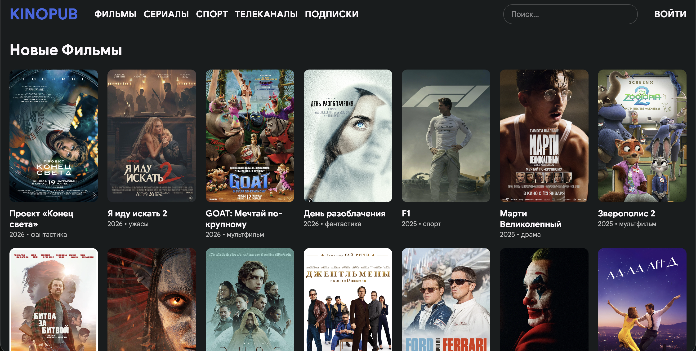
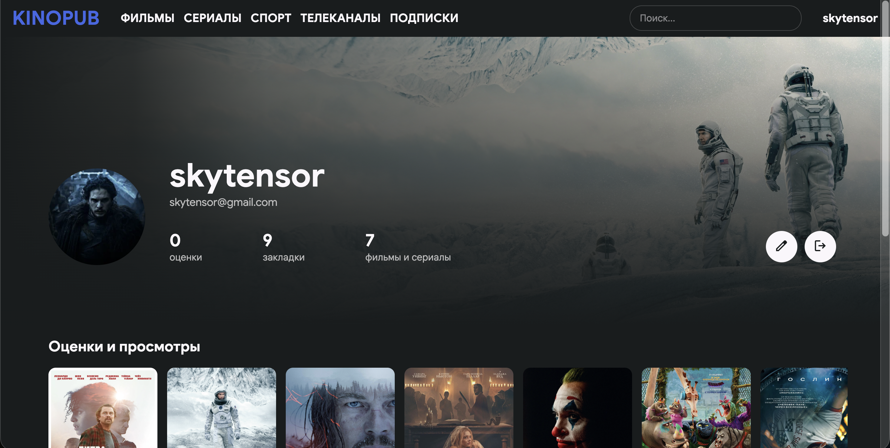
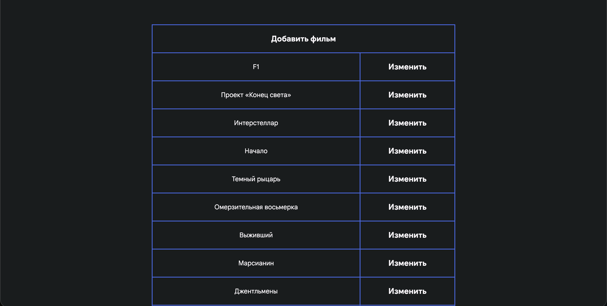
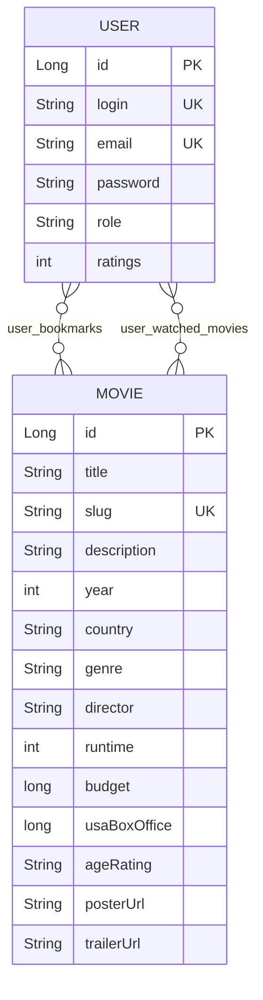

# 🎬 KINOPUB

A full-stack movie catalog web application built with **Java 21** and **Spring Boot 4**. Users can browse and search movies, keep a personal watchlist and a "watched" list, and administrators manage the catalog through a dedicated admin panel.


## Screenshots

| Home | Movie page |
|------|------------|
|  |  |
| **Profile** | **Admin panel** |
|  |  |

> The interface is in Russian.

## Features

**For visitors and users**
- Home page with the latest movies, sorted by release year
- Full catalog with pagination (21 movies per page, compact page window)
- Search by title (case-insensitive, paginated, empty-result message)
- Movie page with poster, backdrop, trailer and detailed credits: director, screenplay, producer, cinematographer, composer, production designer, editor, budget, US box office, age rating and runtime
- Registration and login with form-based authentication and inline validation messages
- **Bookmarks**: save a movie to your list
- **Watched list**: mark a movie as watched
- Profile page with your bookmarks and watched movies
- Proper error pages (404, 403, 400 and a generic fallback)

**For administrators**
- Admin panel: list, create, edit and delete movies
- Form validation with field-level errors and a unique, URL-safe `slug`
- Deleting a movie also removes it from all users' bookmarks and watched lists
- Access is restricted to the `ADMIN` role

**Backend**
- Passwords are hashed with BCrypt
- Server-side validation with Jakarta Validation (registration form, movie form and REST API)
- REST API for creating and deleting movies (admin only)
- Transactional service layer; Open-Session-In-View is disabled
- Schema is generated automatically by Hibernate

## Tech Stack

| Layer       | Technologies                                          |
|-------------|-------------------------------------------------------|
| Language    | Java 21                                               |
| Framework   | Spring Boot 4.0.6, Spring MVC                         |
| Security    | Spring Security, role-based access with method security (`@PreAuthorize`) |
| Persistence | Spring Data JPA (Hibernate), MySQL                    |
| Views       | Thymeleaf, Thymeleaf Spring Security extras, custom CSS |
| Validation  | Spring Boot Starter Validation (Jakarta Validation)   |
| Boilerplate | Lombok                                                |
| Build       | Maven (Maven Wrapper included)                        |
| Deployment  | Docker (multi-stage build, non-root runtime image)    |

## Architecture

The project uses a layered MVC architecture:

```
src/main/java/com/project/code
├── config/        Spring Security configuration
├── controller/    Web controllers and the REST controller
├── dto/           Form objects (MovieForm, RegisterForm)
├── mapper/        Mapping between forms and entities
├── model/         JPA entities (Movie, User)
├── repository/    Spring Data JPA repositories
└── service/       Business logic (MovieService, UserMovieService)
                   and UserDetails for Spring Security
```

```
Browser / API client
        │
        ▼
  Controllers  ──  Thymeleaf views / JSON
        │
        ▼
    Services   ──  transactions, business rules
        │
        ▼
  Repositories  ──  Spring Data JPA
        │
        ▼
      MySQL
```

### Database schema

Tables are created by Hibernate (`ddl-auto=update`). Bookmarks and watched movies are two many-to-many relations between users and movies. `movie.slug` is unique.



> The `MOVIE` entity has more fields (tagline, screenplay, producer, composer, etc.); the diagram shows the main ones.

## Getting Started

### Prerequisites

- JDK 21
- MySQL server
- Git
- Docker (optional, only for the container setup)

Maven does not need to be installed: the project includes the Maven Wrapper.

### 1. Clone the repository

```bash
git clone https://github.com/skytensor/kinopub.git
cd kinopub
```

### 2. Create the database

```sql
CREATE DATABASE movies CHARACTER SET utf8mb4 COLLATE utf8mb4_unicode_ci;
```

It is better not to run the application as `root`. Create a dedicated user with access to this database only:

```sql
CREATE USER 'kinopub'@'%' IDENTIFIED BY 'choose_a_strong_password';
GRANT ALL PRIVILEGES ON movies.* TO 'kinopub'@'%';
```

### 3. Configure the application

All settings are read from environment variables, so no credentials are stored in the repository.

| Variable        | Required | Default                                  | Description                                                    |
|-----------------|----------|------------------------------------------|----------------------------------------------------------------|
| `DB_USERNAME`   | yes      | none                                     | Database user                                                  |
| `DB_PASSWORD`   | yes      | none                                     | Database password                                              |
| `DB_URL`        | no       | `jdbc:mysql://localhost:3306/movies`     | JDBC URL. For a remote database add `?sslMode=REQUIRED`        |
| `PORT`          | no       | `8080`                                   | HTTP port                                                      |
| `COOKIE_SECURE` | no       | `false`                                  | Set to `true` in production behind HTTPS (secure session cookie) |
| `SHOW_SQL`      | no       | `false`                                  | Set to `true` to log SQL statements while debugging            |

**Linux / macOS**
```bash
export DB_USERNAME=kinopub
export DB_PASSWORD=your_password
```

**Windows (PowerShell)**
```powershell
$env:DB_USERNAME="kinopub"
$env:DB_PASSWORD="your_password"
```

> Do not commit IDE files or `.env` files with real credentials. In IntelliJ IDEA, keep secrets in system environment variables rather than in the run configuration inside the project.

### 4. Run

```bash
# Linux / macOS
./mvnw spring-boot:run

# Windows
.\mvnw.cmd spring-boot:run
```

Open **http://localhost:8080**. Tables are created automatically on the first start.

### Run with Docker

```bash
docker build -t kinopub .

docker run --rm -p 8080:8080 \
  -e DB_URL="jdbc:mysql://host.docker.internal:3306/movies" \
  -e DB_USERNAME=kinopub \
  -e DB_PASSWORD='your_password' \
  kinopub
```

On Linux add `--add-host=host.docker.internal:host-gateway` so the container can reach MySQL on the host.

The image is built in two stages (JDK for the build, JRE for runtime), runs as a non-root user, respects container memory limits (`MaxRAMPercentage=75`) and shuts down gracefully. Dependencies are cached in a separate layer, so rebuilds after code changes are fast.

For production deployment set `COOKIE_SECURE=true` and use a database connection with TLS.

### 5. Create an admin account

New users always get the `USER` role. To get admin access:

1. Register a user at `/register`
2. Promote it in the database:
   ```sql
   UPDATE `user` SET role = 'ADMIN' WHERE login = 'your_login';
   ```
3. Log out and log in again (the role is stored in the session at login), then open **http://localhost:8080/admin**

### 6. Add movies

The database starts empty. Use the admin panel (`/admin` → add movie) to create the first movies. Each movie needs a title, a slug (used in the URL, e.g. `/movies/inception`), a poster URL, year, country, genre, credits, age rating and runtime.

## Routes

Everything not listed here is denied by default.

### Web pages

| Method   | Route                          | Access        | Description                              |
|----------|--------------------------------|---------------|------------------------------------------|
| GET      | `/`                            | Public        | Home page, latest movies                 |
| GET      | `/movies?page=0`               | Public        | Catalog with pagination                  |
| GET      | `/search?query=...&page=0`     | Public        | Search by title (empty query redirects to the catalog) |
| GET      | `/movies/{slug}`               | Public        | Movie details (404 if not found)         |
| GET/POST | `/register`                    | Public        | Registration                             |
| GET/POST | `/login`                       | Public        | Login                                    |
| GET      | `/profile`                     | Authenticated | Profile, bookmarks, watched movies       |
| POST     | `/bookmark/add/{movieId}`      | Authenticated | Add a movie to bookmarks                 |
| POST     | `/movies/watch/{movieId}`      | Authenticated | Mark a movie as watched                  |
| GET      | `/admin`                       | Admin         | Admin dashboard                          |
| GET/POST | `/admin/movies/new`            | Admin         | Create a movie                           |
| GET/POST | `/admin/movies/edit/{id}`      | Admin         | Edit a movie                             |
| POST     | `/admin/movies/delete/{id}`    | Admin         | Delete a movie                           |

### REST API

The API is protected by the admin session and CSRF, so it is meant to be called from the browser session (token-based API access is on the roadmap).

| Method | Endpoint                 | Access | Description                                                              |
|--------|--------------------------|--------|--------------------------------------------------------------------------|
| POST   | `/api/movies`            | Admin  | Create a movie from a JSON body. `201` with `Location` and `{"id": ...}`, `400` on validation errors, `409` if the slug exists |
| DELETE | `/api/movies/{slug}`     | Admin  | Delete a movie by slug. `204` on success, `404` if not found             |

### Validation rules

**Registration**
- Login: 4–10 characters, letters, digits and `_`, unique
- Email: valid format, unique (stored in lower case)
- Password: 8–64 characters and at most 72 bytes (BCrypt limit; Cyrillic characters take 2 bytes each), must match the confirmation field

**Movie (admin form and API)**
- Title, country, genre and all credits are required, up to 255 characters
- Slug: required, unique, lowercase Latin letters, digits and hyphens (e.g. `inception-2010`)
- Poster URL is required; poster, backdrop and trailer URLs must be `http(s)` links without spaces or quotes
- Description: up to 2000 characters
- Year: 1888–2100, runtime: 1–1000 minutes, budget and box office: not negative

## Security

- BCrypt password hashing, CSRF protection on all state-changing requests
- Deny-by-default authorization: public routes are listed explicitly, everything else is rejected
- Role-based access (`ADMIN`) for `/admin/**` and `/api/**`, plus `@PreAuthorize` on the API
- The session stores only the user id, login and role, not the full entity
- Session cookie is `HttpOnly`, `SameSite=Lax` and `Secure` when `COOKIE_SECURE=true`
- Forms and the API validate input on the server; Thymeleaf escapes all output

## What I Learned

- Structuring a Spring Boot application into controllers, services, repositories, DTOs and mappers
- Configuring form login, BCrypt password hashing and role-based authorization with Spring Security, including deny-by-default rules and `@PreAuthorize` method security
- Modeling many-to-many relations (bookmarks, watched movies) with Spring Data JPA and keeping them consistent on delete
- Working without Open-Session-In-View: explicit transactions and lazy-loading boundaries
- Server-side validation, field-level errors and dynamic pages with Thymeleaf
- Keeping credentials out of the codebase with environment variables
- Building small, secure Docker images with multi-stage builds and layer caching
- Reviewing my own code for security and reliability issues

## Roadmap

- [ ] Unit and integration tests (currently only a context-load test that needs a running MySQL); use H2 or Testcontainers
- [ ] Database migrations with Flyway instead of `ddl-auto=update`
- [ ] Remove a movie from bookmarks and from the watched list
- [ ] Filter the catalog by genre, year and country
- [ ] `GET` endpoints in the REST API, token-based API authentication and OpenAPI / Swagger documentation
- [ ] Login rate limiting
- [ ] Docker Compose setup (application + MySQL)
- [ ] Series, sports, TV channels and subscriptions sections (currently placeholders in the navigation)

## Author

**Asset Tashmakhambet**: Java Backend Developer, Information Systems student at SDU University

- GitHub: [@skytensor](https://github.com/skytensor)
- LinkedIn: [asset-tashmakhambet](https://www.linkedin.com/in/asset-tashmakhambet/)
- Email: tashmakhambetasset@gmail.com
